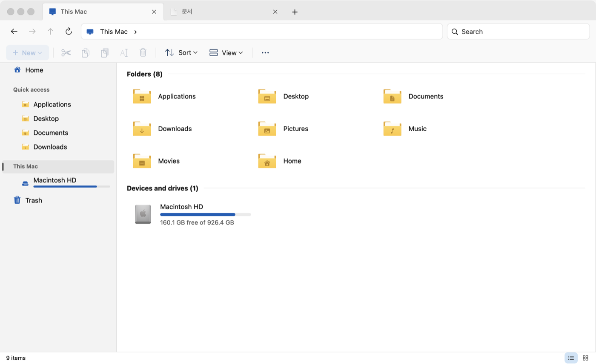
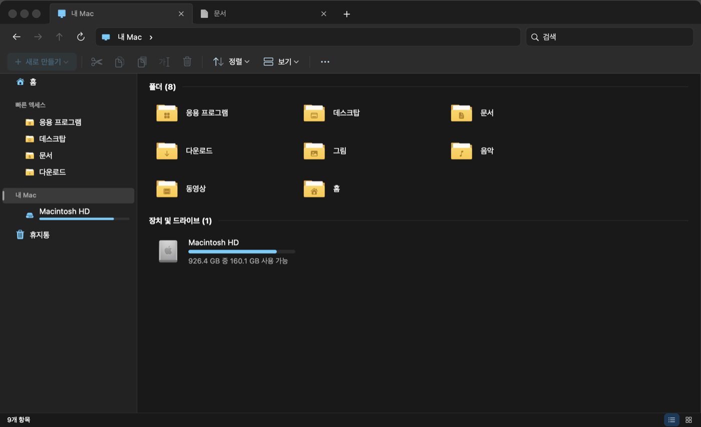

# Explorer for Mac

A file manager for macOS that works like Windows 11 File Explorer.
Made for people coming from Windows who find Finder unfamiliar.

[한국어 설명은 아래에 있습니다.](#한국어)



## Why

Finder works differently from File Explorer in ways that trip up Windows users.
Enter renames instead of opening. There is no cut and paste. Backspace does nothing.
You can't type a path into an address bar. Folders are not listed first.

Explorer for Mac keeps the Windows habits and the Mac look.

| Windows habit | Explorer for Mac | Finder |
|---|---|---|
| Enter opens | Enter opens | Return renames |
| F2 renames | F2 | Return |
| Cut and paste | Cmd+X, then Cmd+V | Cmd+C, then Cmd+Option+V only |
| Backspace goes back | Backspace = Back, Option+Up = Up one level | Cmd+[ / Cmd+Up |
| Delete sends to the bin | Forward Delete, Cmd+Backspace, Ctrl+D | Cmd+Backspace |
| Type a path in the address bar | Cmd+L, Option+D, F4. Accepts `~`, `\` and `%USERPROFILE%` | Cmd+Shift+G dialog |
| Folders first | Always, with natural number sorting | Needs a setting |
| New text document | New menu | None |
| Copy as path | Right-click or Cmd+Shift+C | Option + right-click |
| Paste in the same folder | "Name - Copy" | "Name copy" |
| Replace a folder | Merges, as on Windows | Replaces the whole folder |

Most Ctrl shortcuts are accepted as Cmd. Ctrl+click still opens the context menu, as on macOS.

Also included:
- Tabs, Quick access with pinning, a This Mac view with drive usage
- Details and icon views, preview pane, Properties window
- Copy progress window with speed, time left and Cancel. Cancel rolls back.
- Undo and redo for file operations, Windows-style conflict dialog
- Compress to ZIP and Extract All. ZIP entries are marked as UTF-8 for non-English file names.
- Light and dark themes. English and Korean, following the system language.

## Install

1. Download `Explorer-x.y.z.zip` from [Releases](../../releases).
2. Unzip it and move `Explorer.app` to the Applications folder.
3. Open it.

The app is not notarized by Apple, so macOS blocks the first launch.
To allow it, open System Settings > Privacy & Security, scroll down and click **Open Anyway**.
Or run this once in Terminal:

```sh
xattr -dr com.apple.quarantine /Applications/Explorer.app
```

Requires macOS 14 or later. Runs natively on Apple silicon and Intel.

## Build from source

Requires Xcode 16 or later (Swift 6 toolchain).

```sh
scripts/build-app.sh            # build/Explorer.app (release, universal, ad-hoc signed)
scripts/package.sh              # build/Explorer-<version>.zip
open build/Explorer.app --args /path/to/folder   # start in a folder
swift test                      # core unit tests
python3 scripts/check-strings.py   # check for missing translations
```

## Project layout

| Module | Role |
|---|---|
| `Sources/ExplorerCore` | File operations, sorting, history, address parsing, search, folder watching. Foundation only |
| `Sources/Explorer` | AppKit UI, built in code without storyboards |
| `Tests/ExplorerCoreTests` | Core unit tests |
| `Resources/*.lproj` | English and Korean strings. Korean source text is the key |

Design and review documents are in [docs](docs), written in Korean.

## License

[MIT](LICENSE)

---

## 한국어

macOS 에서 Windows 11 파일 탐색기처럼 동작하는 파일 관리자입니다.
Windows 에서 넘어와 Finder 가 낯선 사용자를 위해 만들었습니다.



### Finder 와 다른 점

| Windows 습관 | 이 앱 | Finder |
|---|---|---|
| Enter 로 열기 | Enter = 열기 | Return = 이름 바꾸기 |
| F2 이름 바꾸기 | F2 | Return |
| 잘라내기 후 붙여넣기 | Cmd+X 후 Cmd+V | Cmd+C 후 Cmd+⌥+V 만 |
| Backspace 뒤로 | ⌫ = 뒤로, ⌥↑ = 상위 폴더 | Cmd+[ / Cmd+↑ |
| Delete 휴지통 | ⌦, Cmd+⌫, Ctrl+D | Cmd+⌫ |
| 주소 표시줄 직접 입력 | Cmd+L, ⌥D, F4. `~`, `\`, `%USERPROFILE%` 허용 | Cmd+Shift+G 대화상자 |
| 폴더 우선 정렬 | 모든 정렬에서 폴더가 먼저 | 설정 필요 |
| 새 텍스트 문서 | 새로 만들기 메뉴 | 없음 |
| 경로 복사 | 우클릭 또는 Cmd+Shift+C | ⌥ + 우클릭 |
| 같은 폴더 붙여넣기 | "이름 - 복사본" | "이름 copy" |
| 폴더 덮어쓰기 | 병합 (Windows 와 같음) | 대상 폴더 교체 |

### 설치

1. [Releases](../../releases) 에서 `Explorer-x.y.z.zip` 을 받습니다.
2. 압축을 풀고 `Explorer.app` 을 응용 프로그램 폴더로 옮깁니다.
3. 실행합니다.

Apple 공증을 받지 않은 앱이라 처음 실행은 macOS 가 막습니다.
시스템 설정 > 개인정보 보호 및 보안 아래쪽에서 **그래도 열기** 를 누릅니다.
또는 터미널에서 위의 `xattr` 명령을 한 번 실행합니다.

macOS 14 이상이 필요합니다. Apple 실리콘과 Intel 에서 모두 동작합니다.

### 문서

| 문서 | 내용 |
|---|---|
| [docs/research.md](docs/research.md) | Windows 탐색기와 Finder, 대안 앱 비교 조사 |
| [docs/SPEC.md](docs/SPEC.md) | 기능 정의서와 완료 기준 |
| [docs/DESIGN.md](docs/DESIGN.md) | 디자인 기준서 |
| [docs/review-core.md](docs/review-core.md) | Core 리뷰와 재검증 기록 |
| [docs/review-ui.md](docs/review-ui.md) | UI 리뷰와 재검증 기록 |
